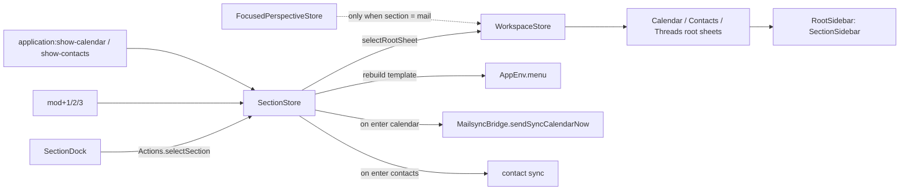

# Section Dock: In-Place Mail / Calendar / Contacts Switching

Issue: [#30](https://github.com/AnsCodeLab/Mailspring/issues/30)

## Goal

A dock is pinned to the bottom of the main window's left column. It holds **Mail**, **Calendar**, **Contacts** and an **overflow ⋯** menu. Selecting a section switches the main window in place: the left panel contents, center columns, toolbar, menus and active keyboard commands all change. The separate Calendar and Contacts windows remain available through "Open in New Window".

## Decisions

| Topic | Decision |
|---|---|
| Left panel | One shared `RootSidebar` column; its contents change per section and the dock is always visible |
| Separate windows | Kept; reachable from the dock context menu and the Window menu |
| Section shortcuts | `mod+1` Mail, `mod+2` Calendar, `mod+3` Contacts |
| Account selection | Moves from `mod+1..9` to `mod+alt+1..9` |
| Calendar views | Day/Week/Month/Agenda move from `mod+1..4` to `mod+shift+1..4`; `ctrl+cmd+1..4` on macOS, where `cmd+shift+3/4` take screenshots |
| Startup | Always Mail; the active section is not persisted |

## Current constraints (why this is not just a button)

- `main-calendar` and `contacts` set `windowTypes` to `calendar` / `contacts` only, so they never load in the main window (`package-manager.ts:99-110`).
- Both packages call `adjustMenus()` in `activate()`. It removes the `Thread` and `View` menus permanently, and `deactivate()` does not restore them.
- `contacts` calls `Actions.selectRootSheet(Contacts)` in `activate()`. Its `Store` calls `AppEnv.displayWindow()` in its constructor.
- `FocusedPerspectiveStore._setPerspective` re-selects the mail root sheet on every perspective change (`focused-perspective-store.ts:189-197`).
- `MailspringCalendar` renders its own `ResizableRegion.calendar-source-list` containing `CalendarSourceList` and `MiniMonthView`, and registers at `Location.Center`.
- `core:add-item`, `core:delete-item`, `core:focus-search` and `core:remove-from-view` are bound on `document.body` by mail, calendar and contacts components alike. They are safe only when one section is mounted at a time.
- Nothing listens for `run-contact-sync` (`application.ts:459`).
- The calendar's "preview, read-only, Google only" `Notice` is out of date: create, update, drag and delete all go through `SyncbackEventTask` / `DestroyEventTask`.

## Architecture

### 1. `SectionStore` (`app/src/flux/stores/section-store.ts`)

- State: `current: SectionId` (`'mail' | 'calendar' | 'contacts'` plus registered overflow ids), and `mailRootSheet`, the mail root sheet to restore on return.
- `registerSection({ id, title, icon, order, rootSheet, menu?, hiddenMenuIds?, onEnter?, overflow? })` returns a disposable. Mail is registered by core; calendar and contacts register from their packages in the main window. `sections()` is sorted by `order` (Mail 0, Calendar 10, Contacts 20), overflow sections last, so the dock order does not depend on package activation order.
- `Actions.selectSection(id)`:
  1. If the target is the current section, do nothing.
  2. On leaving Mail, record `WorkspaceStore.rootSheet()`.
  3. `Actions.selectRootSheet(target.rootSheet)`; Mail restores the recorded sheet.
  4. Rebuild menus (see below).
  5. Run `onEnter`.
  6. `trigger()`.
- Menus: snapshot `AppEnv.menu.template` once, after packages activate, as the base. On each switch, set `template = base` minus `hiddenMenuIds`, with the section's `menu` spliced in after `Edit`, then call `AppEnv.menu.update()`.
- Exported from `mailspring-exports` as `SectionStore`.

### 2. `FocusedPerspectiveStore`

`_setPerspective` changes the root sheet only when `SectionStore.current() === 'mail'`. Selecting a mail folder from another section (e.g. via `g i`) first calls `Actions.selectSection('mail')`.

### 3. Root sheets in the main window

- Both `package.json` files gain `"default": true` in `windowTypes`.
- `activate()` branches on `AppEnv.getWindowType()`:
  - Main window (`default`): define the root sheet and register components and the section. Never select the sheet, and never mutate menus.
  - Its own window (`calendar` / `contacts`): today's behaviour, minus the stale `Notice`.
- Sheets:
  - `Calendar`: `{ root: true }`, `list/split/splitVertical: ['RootSidebar', 'CalendarContent']`.
  - `Contacts`: `{ root: true }`, `list/split/splitVertical: ['RootSidebar', 'ContactsList', 'ContactsDetail']`.
- `MailspringCalendar` registers at `CalendarContent` in the main window and at `Center` in its own window. Toolbar items (`QuickEventButton`, `EventSearchBar`) register at the matching `.Toolbar` location.
- `deactivate()` undoes everything `activate()` did (unregisters every component and disposes the section registration).
- The contacts `Store` no longer calls `AppEnv.displayWindow()`; the contacts window's `activate()` calls it.

### 4. Shared left column

- A `SectionSidebar` component is registered at `Location.RootSidebar`. It renders:
  - a header with the section title;
  - the active section's panel, found through `InjectedComponentSet` with role `SectionSidebar:<id>`;
  - the `SectionDock`, pinned at the bottom.
- `AccountSidebar` re-registers under role `SectionSidebar:mail` instead of `Location.RootSidebar`. Other `RootSidebar` registrants (notifications' `ActivitySidebar` / `NotifWrapper`) move to the mail role so they keep showing in Mail.
- Calendar panel (`SectionSidebar:calendar`): `CalendarSourceList`, then a flexible spacer, then `MiniMonthView` directly above the dock. Both are extracted from `MailspringCalendar`. Selection state (visible calendars, focused date) moves to a small `CalendarViewStore` (module scope in `main-calendar`) so that both the panel and `MailspringCalendar` read it.
- In the separate calendar window, `MailspringCalendar` keeps rendering the same panel inside its `ResizableRegion`, so the extracted component serves both layouts.
- Contacts panel (`SectionSidebar:contacts`): `ContactPerspectivesList` plus `AddContactToolbar`.
- Column width persists unchanged, because every section uses the same `RootSidebar` location id.

### 5. `SectionDock`

- A row of icon buttons for registered non-overflow sections, followed by ⋯ when any overflow sections exist. The ⋯ menu also offers "Customize…" (out of scope; it is not rendered until implemented).
- The active section gets an accent underline and `aria-current="page"`. Each button is a `role="tab"` inside a `role="tablist"`.
- Tooltips: title and shortcut (e.g. "Calendar (Ctrl+2)").
- Context menu on Calendar and Contacts: "Open in New Window", which dispatches `application:show-calendar-window` / `application:show-contacts-window`.
- Narrow sidebar: icons only. This is the default.

### 6. Commands and keymaps

- New commands, registered by `SectionStore` on `document.body`:
  - `navigation:section-mail` → `mod+1`
  - `navigation:section-calendar` → `mod+2`
  - `navigation:section-contacts` → `mod+3`
- `window:select-account-0..8` move to `mod+alt+1..9` (`keymaps/base.json`, `account-commands.ts` menu accelerators).
- `calendar:view-day/week/month/agenda` move to `mod+shift+1..4` on Linux and Windows and `ctrl+cmd+1..4` on macOS (`main-calendar/keymaps/calendar-<platform>.json`; package keymaps named `<name>-<platform>.json` load only on that platform). The calendar menu labels update with them.
- `navigation:go-to-contacts` (`g c`, currently a TODO no-op) becomes `selectSection('contacts')`.
- Audit `mod+shift+r`, `mod+t`, `mod+left/right` and the plain arrow keys in `calendar.json` against `base.json` and every template. Any conflicting key is moved, or scoped through `KeyCommandsRegion` local handlers.
- Inactive sections are unmounted, so their `BindGlobalCommands` handlers detach and the shared `core:*` commands reach only the visible section.

### 7. Sync and entry points

- Calendar `onEnter`: `MailsyncBridge.sendSyncCalendarNow()`.
- Contacts `onEnter`: the contact-sync equivalent. Add the missing `run-contact-sync` receiver in `MailsyncBridge`, and verify which sync-engine message is needed.
- `application:show-calendar` / `application:show-contacts`: focus the main window, then send `select-section` to it.
- New `application:show-calendar-window` / `application:show-contacts-window` keep the old `ensureWindow(...)` path.
- Menus (`app/menus/{darwin,linux,win32}.js`):
  - Window → Mail / Calendar / Contacts (section switch).
  - Window → Open Calendar in New Window / Open Contacts in New Window.
  - Remove Developer → "Calendar Preview".
- `preferences-account-details.tsx:179` keeps sending `application:show-contacts`, which now switches in place.

## Error handling

- `selectSection` with an unknown id logs a warning and does nothing.
- If the calendar or contacts package is disabled, its section is never registered, so the dock omits it.
- A sync trigger failure when entering a section is non-fatal; the section shows cached DB data.

## Testing

Specs (Jasmine, `app/spec/`):
- `section-store-spec.ts`:
  - switching selects the right root sheet;
  - returning to Mail restores Threads / Drafts / Activity;
  - same-section selection does nothing;
  - menus: hidden ids removed, section menu inserted, base restored exactly on return to Mail;
  - `onEnter` runs once per entry.
- `focused-perspective-store` addition: a perspective change while in Calendar does not change the root sheet.
- Keymap spec: across `base.json`, every template, and the package keymaps, no keystroke maps to two different commands.

Smoke test (manual, all three layout modes, Linux; Windows/macOS through the release builds):
- the dock switches all three sections;
- the mini-month sits above the dock;
- `core:delete-item` in Calendar deletes the selected event and never a thread;
- the menus match the section;
- "Open in New Window" still works;
- restarting opens Mail.

## Out of scope

- New sections (Tasks, Notes); the overflow menu only provides the extension point.
- Dock customization UI.
- New calendar features.

## Changelog notes

- Account selection shortcuts change from `Ctrl/Cmd+1..9` to `Ctrl/Cmd+Alt+1..9`.
- Calendar view shortcuts change to `Ctrl+Shift+1..4` (Linux, Windows) and `Ctrl+Cmd+1..4` (macOS).
- Calendar and Contacts open inside the main window. Separate windows remain available through "Open in New Window".

## Implementation notes

- Menus: `SectionStore` stashes only the active section's hidden top-level menus and restores them on leaving it, rather than restoring a template snapshot, because `account-commands` rewrites the Window submenu at runtime.
- Contacts has no sync trigger on entry: the sync engine has no contacts sync message, so it syncs contacts on its own schedule. Entering Contacts starts the contact queries instead.

See the plan's [Deviations from the spec](../plans/2026-10-15-section-dock.md#deviations-from-the-spec-found-while-planning).
